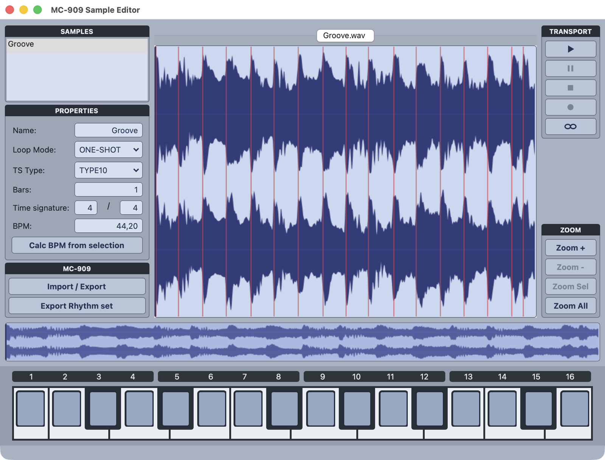
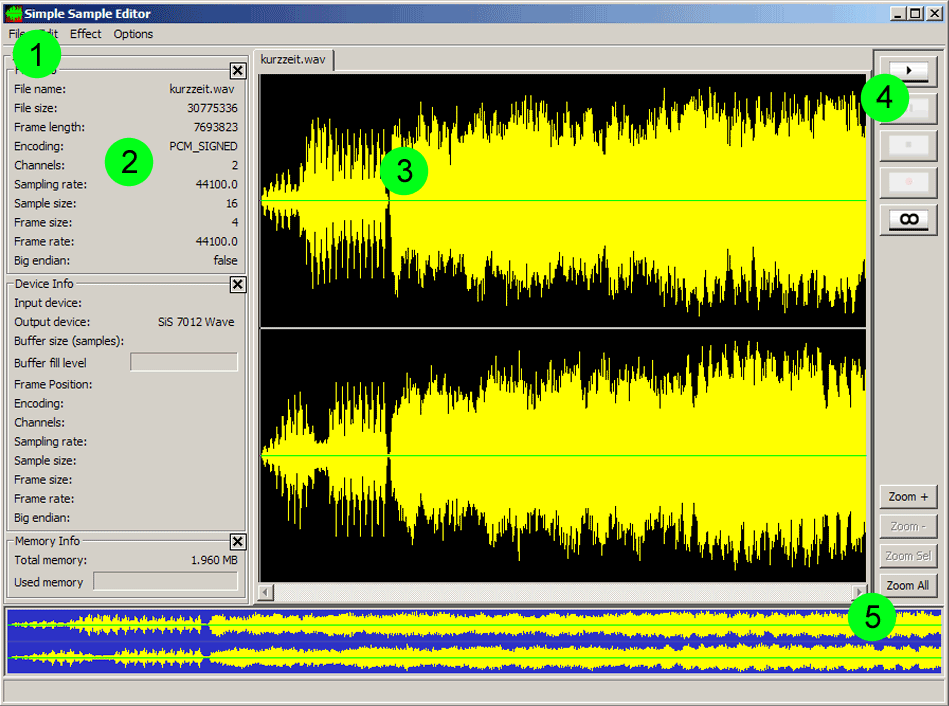
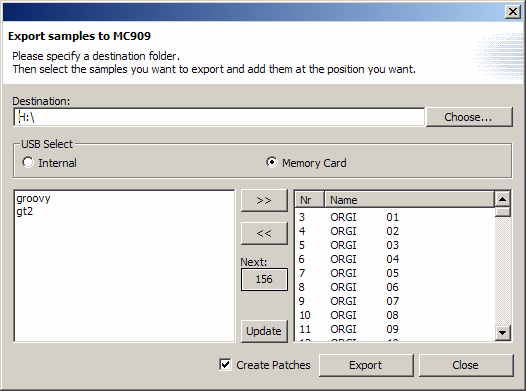
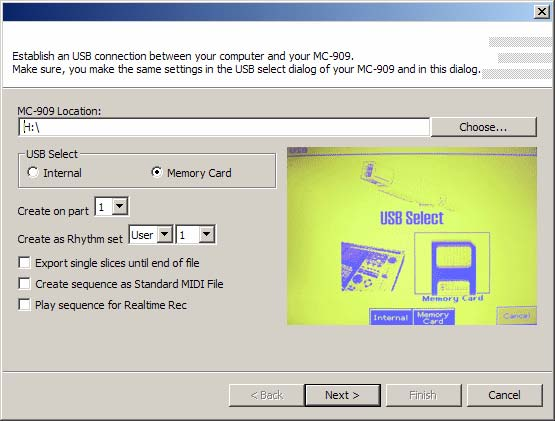
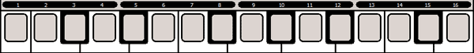

# GrooveManager MC-909 Sample Editor

A sample editor for the Roland MC-909 groovebox, written in Java (SWT/JFace, Java Sound) in 2004 as the practical part of my diploma thesis [*"Java Sound als Plattform für die Entwicklung studiotauglicher Audioapplikationen"*](docs/thesis/diplomarbeit.pdf) ("Java Sound as a platform for developing studio-grade audio applications", Hochschule der Medien Stuttgart, August 2004). This repository holds the sources of release 1.0 (2004-08-08), revived to run on a current Java.

> **Status:** `main` builds with Gradle and runs on Java 25 with current SWT/JFace (see [Running it today](#running-it-today)). The changes needed for that are kept small and are listed below. The original 2004 state is tagged [`v1.0`](../../tree/v1.0), and its release has the original distribution zips.



## Features (2004)

There are two applications:

**Simple Sample Editor** (`app/sse`), the basic version:
- Opens any number of files in tabs, in every format a Java Sound plugin can read. Files can also be opened by drag and drop. Saving is WAV only.
- **Non-destructive editing** with cut lists: Copy, Cut, Paste, Delete, Trim, and unlimited Undo/Redo.
- **Effects** through a plugin interface (`META-INF/services/com.groovemanager.sampled.fx.Effect`): Normalize, Pseudo Echo, Chorus/Flanger (experimental). Each effect is applied non-destructively through a temporary file.
- **Waveform display** with cached peak files, selection, markers (add with Ctrl+click, ⌘+click on macOS; move with Shift and the arrow keys), zoom, and an overview of the whole file.
- **Streaming playback and recording.** The Settings dialog has driver selection, buffer size and player thread priority. Info panels show the file, the device (including buffer fill level) and JVM memory.



**MC-909 Sample Editor** (`app/mc909se`) extends the basic version for the Roland MC-909:
- **Per-sample MC-909 properties:** name, loop mode, time-stretch type, bars/time signature/BPM, with BPM calculated from the selection.
- **Sample import/export** to and from the MC-909 in USB storage mode (internal flash or SmartMedia card). The WAV files carry the chunks the MC-909 expects. Patches can be created automatically over MIDI SysEx. They then have to be saved on the device, because saving remotely isn't possible.
- **Rhythm set export** from a sample split up with markers, one slice per pad. Optional: the slice sequence as a Standard MIDI File, or played to the MC-909 over MIDI (with its own MIDI Clock implementation, because Java Sound's sequencer lacked it) for realtime recording.
- **Preview** through on-screen MC-909 pads or an external MIDI keyboard. This was a hard realtime requirement.

| | |
|---|---|
|  |  |



Also part of the thesis:
- **Java Sound plugins:** [jsASIO](https://github.com/mopotmo/jsasio) (ASIO drivers as Java Sound mixers), [jsREX](https://github.com/mopotmo/jsrex) (ReCycle file reader), and [floatconversion](https://github.com/mopotmo/floatconversion) (a `PCM_FLOAT` encoding plus conversions).
- **A separate plugin interface** (`com.groovemanager.sampled.providers`, managed by `AudioManager`) for reading file formats and writing audio files. It works around weaknesses of Java Sound's `AudioFileReader`/`AudioFileWriter` SPIs. Providers declare their supported types, formats and property keys, and `AudioManager` chooses the best match.

Both editors were tested on Windows and Linux in 2004.

## Repository layout

| Path | Contents |
|---|---|
| `app/src/com/groovemanager/core`, `sampled`, `gui`, `actions`, `thread`, `midi`, `pref`, … | The GrooveManager framework, released as `gm.core.jar` |
| `app/src/com/groovemanager/app/sse` | Simple Sample Editor. It was released separately with its own `start.jar` (main class `com.groovemanager.app.sse.Starter`) and is also contained in the MC-909 `start.jar` |
| `app/src/com/groovemanager/app/mc909se`, `gui/custom/mc909` | MC-909 Sample Editor, released as `start.jar` (main class `com.groovemanager.app.mc909se.Starter`) |
| `app/resources/META-INF` | Manifest and service registrations of the released `start.jar` |
| `app/root` | Icons and MC-909 screen images. The app loads them from `./root` at runtime |
| `docs/install` | Original installation notes (German) |
| `docs/thesis/diplomarbeit.pdf` | The diploma thesis (German, 106 pages). Chapter VI describes the editors and plugins in detail |
| `docs/screenshots` | Screenshots from the thesis |
| `samples` | Example sounds from the thesis CD-ROM (16/24/32-bit WAV). A longer recording, "Elektronische Kerzenlichtmusik.wav" (82 MB), is attached to the v1.0 release |

Related repositories:
- [jsASIO](https://github.com/mopotmo/jsasio): ASIO `MixerProvider` for Java Sound (Windows)
- [jsREX](https://github.com/mopotmo/jsrex): ReCycle file reader for Java Sound (Windows)
- [floatconversion](https://github.com/mopotmo/floatconversion): `PCM_FLOAT` encoding and conversions for Java Sound. It was part of this repository up to v1.0

## Running it today

### Installers

The [releases](../../releases) have installers for macOS (Apple Silicon and Intel), Windows and Linux. They include a Java runtime and install the MC-909 Sample Editor. The installers aren't signed:
- **macOS:** on the first start, macOS refuses to open the app. Open *System Settings → Privacy & Security* and click *Open Anyway*, or run `xattr -dr com.apple.quarantine "/Applications/MC-909 Sample Editor.app"`.
- **Windows:** SmartScreen warns about an unknown publisher. Click *More info → Run anyway*.

The installed app writes its log to `~/.groovemanager/error.log`.

### From source

You need a JDK 25 (for example `brew install openjdk@25` on macOS). Gradle and the SWT/JFace libraries for your platform are downloaded by the Gradle wrapper:

```sh
./gradlew run      # MC-909 Sample Editor
./gradlew runSse   # Simple Sample Editor
```

The app runs from the `app` directory and loads its icons from `app/root`. Errors go to `app/root/error.log`. Settings are stored under your home directory. Try the files in `samples/`.

`./gradlew jpackage` builds the installer for the current platform into `build/jpackage/output` (dmg, msi or deb; the msi needs [WiX](https://wixtoolset.org)). The GitHub workflow `.github/workflows/installers.yml` builds all of them for a `v*` tag. The app icon is drawn by `packaging/icon/IconGenerator.java`.

Tested on macOS (Apple Silicon) and Windows. On macOS it was also tested with a Roland MC-909: exporting samples in USB storage mode, and creating patches and rhythm sets over MIDI. Linux should work but hasn't been tested yet. Not working or untested:
- **ASIO and REX:** the plugins are 32-bit Windows DLLs and can't be loaded by a current 64-bit JVM.

What was changed for the revival (see the `Revival:` commits):
- Gradle build (Java 25 toolchain, SWT 3.135 / JFace 3.40 from Maven Central).
- `java.util.ServiceLoader` instead of the removed `sun.misc.Service`, and Java's built-in `PCM_FLOAT` encoding instead of the floatconversion plugin.
- MIDI through [CoreMIDI4J](https://github.com/DerekCook/CoreMidi4J) on macOS, because Java's built-in MIDI there doesn't send SysEx messages. MIDI devices are found when they are plugged in while the app runs.
- `Thread.interrupt()` instead of `Thread.stop()`, which throws since Java 20.
- The waveform is drawn in paint events through an off-screen image. Drawing directly on the control and XOR drawing crash on current macOS. The selection is now drawn semi-transparent.
- `FileManager` takes the resource directory from the system property `groovemanager.root` if set (used by the installers) and then logs to `~/.groovemanager/error.log`.
- macOS: ⌘ instead of Ctrl for shortcuts and marker editing, space for play/stop anywhere in the window, edit actions are updated on every change (macOS doesn't open the menu for shortcuts), file drops from the Finder, and workarounds for SWT layout problems (tab labels, info panels, right bar).
- Themes under *Settings → Appearance*: MC-909 (default, in the colors of the device), MC-909 Editor (after Roland's editor), Modern (dark) and Classic (the 2004 look). They switch live. The MC-909 themes draw their buttons, text fields and dropdowns themselves, because native controls can't be colored on macOS; they can be used with the keyboard and VoiceOver.

## Original 2004 build

The 2004 build was done in Eclipse. There is no build script. To compile the original code (tag `v1.0`) you need:

- **JDK 5 to 8.** `AudioManager` uses `sun.misc.Service`, which was removed in Java 9. The code itself is Java 1.4 style.
- **SWT 3.0.x and JFace 3.0** (`swt.jar`, `jface.jar`, `runtime.jar`, `boot.jar` from Eclipse 3.0) plus the matching SWT native libraries.
- `-encoding UTF-8` (the sources were converted from CP1252 for this repository).

The app expects to be started from its install directory, with the following layout:

```
start.jar  gm.core.jar  root/  ext/*.jar  <native libraries>
java -Djava.library.path=. -jar start.jar
```

The manifest's `Class-Path` lists the jars expected in `ext/`.

## Contributing

Feedback, issues, forks and pull requests are welcome. See [CONTRIBUTING.md](CONTRIBUTING.md). The editor is mainly tested on macOS, so feedback from Windows and Linux is especially welcome. If you like the editor, you can also support it on [Ko-fi](https://ko-fi.com/manurobledo).

## License

MIT, see [LICENSE](LICENSE).
